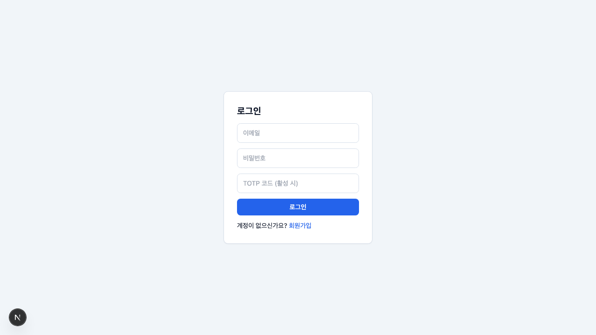
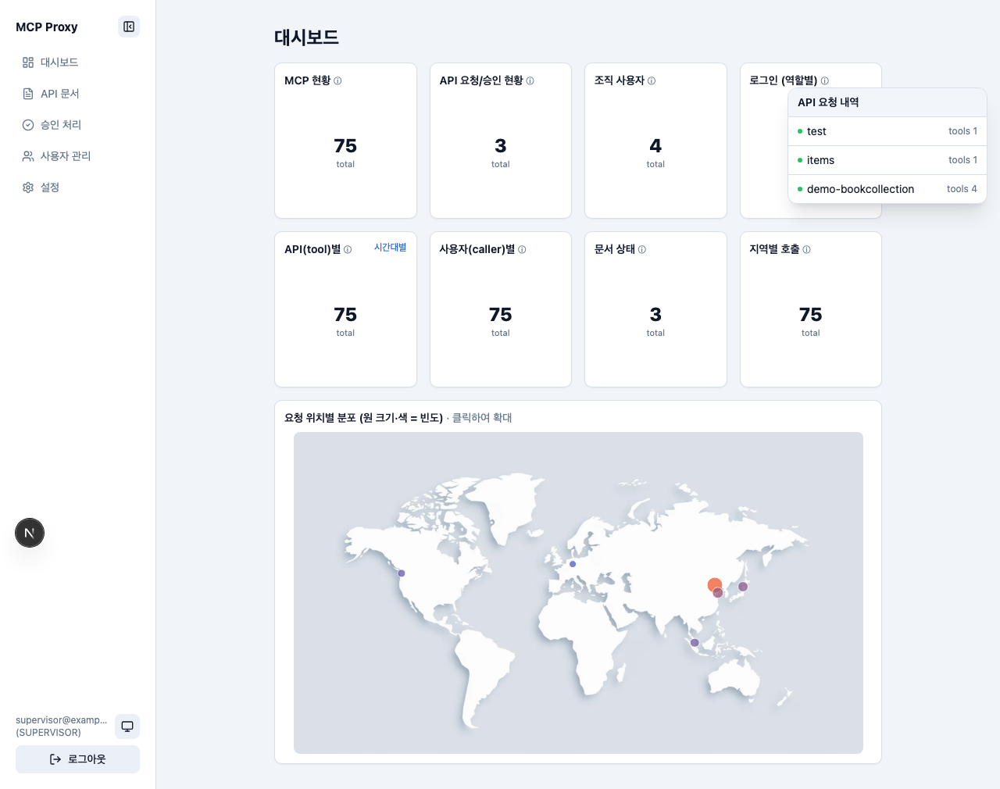
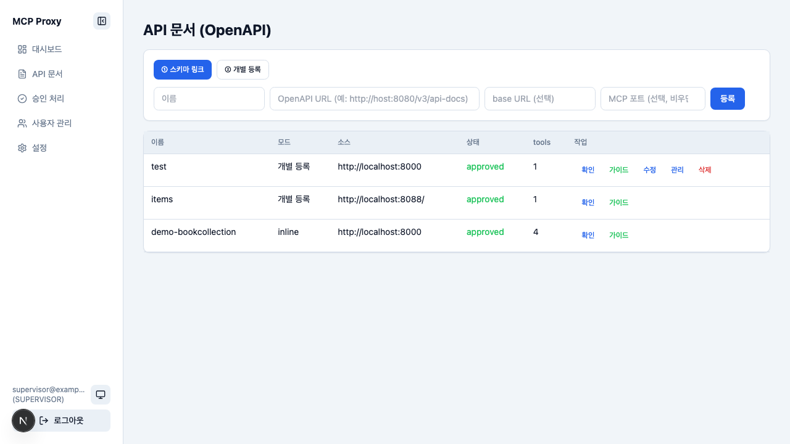
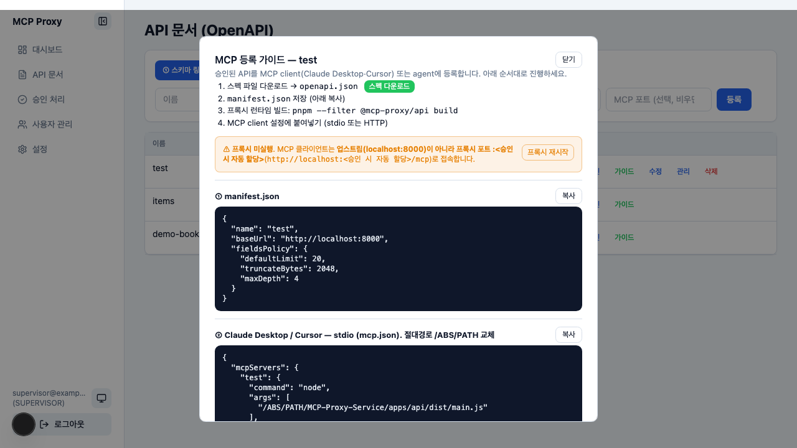
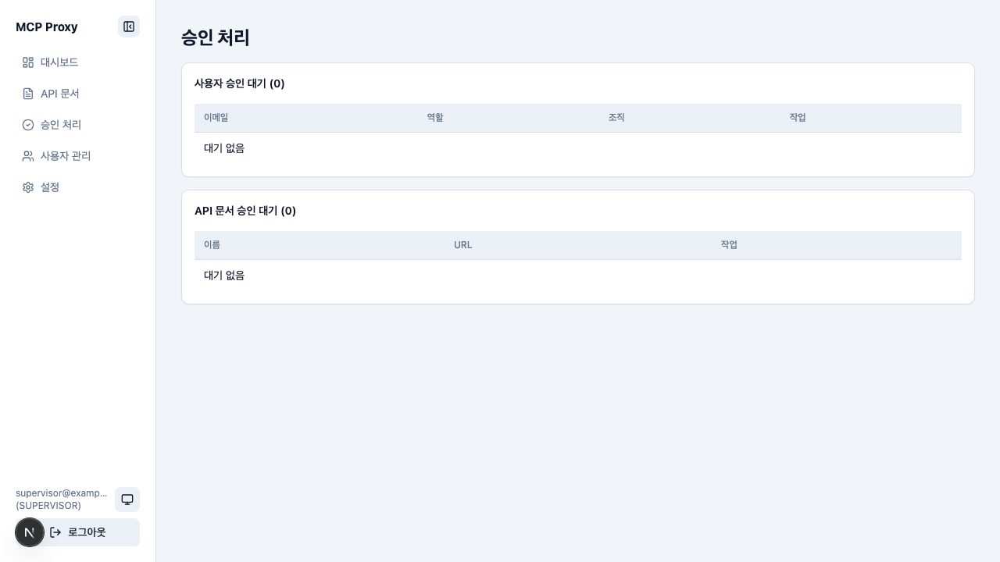
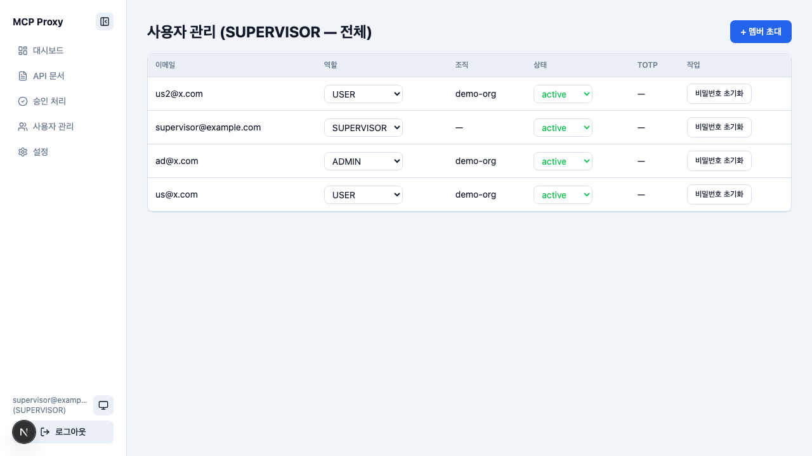
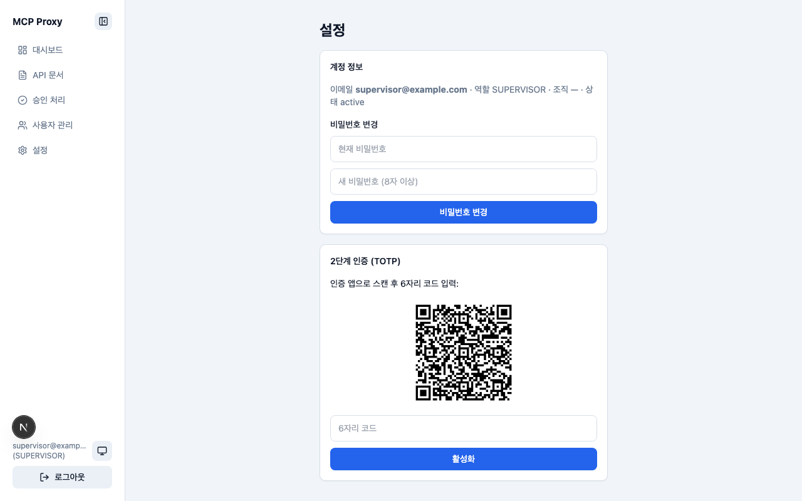

# MCP-Proxy-Service — 웹 UI 분석

> 분석 대상: `http://localhost:3000/`
> 계정: `supervisor@example.com` (역할 **SUPERVISOR** — 전체 권한)
> 분석일: 2026-06-11
> 방법: 헤드리스 브라우저 실제 로그인 + 화면 순회 + 화면캡쳐 (`.doc/MCPProxy/`)

---

## 1. 개요

REST API 문서(OpenAPI URL/파일 또는 비정형 문서)를 입력하면 **무변경(proxy-by-spec) MCP 서버**를
자동 생성·배포하고 클라이언트 등록 가이드까지 출력하는 변환 플랫폼.

- **핵심 불변식**: 런타임 코드 고정. 행동은 OpenAPI 스펙 + manifest(노출 operation·인증·필드 정책)로만 결정. API별 커스텀 코드 0줄.
- **스택**: pnpm 모노레포 (`apps/web` Next.js · `apps/api` 무변경 Proxy 런타임 · `packages/{manifest,converter,extractor,shared}`) + Python(uv) 비정형 추출.
- **DB**: local SQLite (`node:sqlite` 빌트인) / dev+ PostgreSQL + Redis.

UI는 좌측 고정 네비(접힘 토글) + 단일 화면 콘텐츠. 5개 라우트: 대시보드 · API 문서 · 승인 처리 · 사용자 관리 · 설정.

---

## 2. 로그인 / 인증

- 필드: 이메일 · 비밀번호 · **TOTP 코드 (활성 시)** — 2FA 옵션 노출.
- `POST /api/auth/login` → JWT(jose) 발급, `/dashboard` 리다이렉트.
- 좌측 하단 화면모드 토글(시스템🖥→라이트☀️→다크🌙) 로그인 화면에도 적용.
- RBAC: **SUPERVISOR > ADMIN > USER**. SUPERVISOR는 `.env` 첫 부팅 시 1회 자동 생성.

**관찰**: 로그인 200 정상, 콘솔 에러 0. `me`·`apidocs`·`notifications`·`stats/usage` API 즉시 호출 확인.

---

## 3. 대시보드

역할별 그래픽 대시보드 (Shadcn UI Chart / recharts + Tailwind). 텍스트 최소·도식 위주 단일 화면.

- **도넛 8종** (범례 없이 마우스오버 툴팁):
  - 상단 4: MCP 현황(75 total) · API 요청/승인 현황(3) · 조직 사용자(4) · 로그인 역할별(8)
  - 하단 4: API(tool)별(75) · 사용자(caller)별(75) · 문서 상태(3) · 지역별 호출(75)
- **시간대 히트맵**: API(tool)별 카드 우상단 "시간대별" 클릭 → 팝업(가로 top7 · 세로 0–23시 · 색=빈도).
- **세계지도**: static 로컬 PNG(`world-map.png`) 위 요청 위치 마커(크기·색=빈도), 클릭 시 전체화면 확대.
- **API 요청 내역**: 등록 문서 있을 때만 표시. 우상단 호버 시 문서별 tool 수 팝업(test·items·demo-bookcollection).
- 데모 사용내역 60건 + seed 기반 집계 (`/api/stats/usage`).

**관찰**: 좌상단 도넛이 모두 `total` 숫자만 큰 글씨로 노출 — 비율 분해는 호버 의존. 첫 인상에서 성공/실패 비율이 안 보임(개선 여지).

---

## 4. API 문서 (OpenAPI 등록)

핵심 워크플로 화면. 2가지 등록 모드 탭:

- **① 스키마 링크**: OpenAPI URL 등록 (`…/openapi.json`, `…/v3/api-docs`).
- **② 개별 등록**: REST API(메서드+경로)를 Swagger식으로 하나씩 추가 → OpenAPI 자동 합성. `{param}`은 path 파라미터 자동 변환.
- 등록 폼: 이름 · OpenAPI URL · base URL(선택) · **MCP 포트(선택, 비우면 자동)**.

문서 목록 테이블: 이름 · 모드(개별등록/inline) · 소스 · **상태(approved)** · tools 수 · 작업.
- 작업 버튼: **확인**(URL fetch/합성 + 변환 미리보기) · **가이드** · 수정 · 관리 · 삭제.
- 시드 데이터: `test`(8000, tools 1) · `items`(8088, tools 1) · `demo-bookcollection`(inline 8000, tools 4) 모두 approved.

**승인 시 프록시 자동 기동**: 승인 → 20000+ 빈 포트 자동 할당(중복·OS사용중 제외, DB 영속) →
spec/manifest 기록 → `apps/api/dist/main.js`를 `TRANSPORT=http`로 자동 spawn. 반려/수정/삭제 시 자동 중지, 웹 부팅 시 reconcile.

---

## 5. MCP 등록 가이드 (동적 생성)

문서별 "가이드" 클릭 → baseUrl·포트 기반 **동적 모달** + 실시간 프록시 상태.

순서: ① 스펙 다운로드(openapi.json) → ② manifest.json 저장 → ③ 프록시 빌드(`pnpm --filter @mcp-proxy/api build`) → ④ MCP client 설정.

복사 가능 스니펫 5종:
1. **manifest.json** — `name`·`baseUrl`·`fieldsPolicy`(defaultLimit 20 / truncateBytes 2048 / maxDepth 4).
2. **stdio (mcp.json)** — `node apps/api/dist/main.js` + `TRANSPORT=stdio`·`MANIFEST_PATH`·`SPEC_PATH` (절대경로 교체).
3. **HTTP/SSE 실행** — `TRANSPORT=http PORT=<자동할당> node …`.
4. **HTTP client (Claude Desktop)** — `{url}` 미지원 → `mcp-remote` 브리지(npx).
5. **HTTP client (Cursor 등)** — `{url}` 직접 지원.

**경고 배너**: 프록시 미실행 시 "MCP 클라이언트는 업스트림(localhost:8000)이 아니라 **프록시 포트**로 접속" + "프록시 재시작" 버튼.

**관찰**: 가이드가 가장 잘 설계된 부분. 업스트림 vs 프록시 포트 혼동을 배너로 직접 차단, 클라이언트별(Claude/Cursor) 분기 제공 — 온보딩 마찰 최소화.

---

## 6. 승인 처리

2개 섹션: **사용자 승인 대기** + **API 문서 승인 대기**. 현재 둘 다 0건("대기 없음").

- 사용자 승인 테이블: 이메일·역할·조직·작업.
- 문서 승인 테이블: 이름·URL·작업.
- 권한: ADMIN=같은 조직, SUPERVISOR=전체.
- 승인 체인: ADMIN 가입→조직 생성→SUPERVISOR 승인 / USER 가입→조직 검색→해당 조직 ADMIN 승인. 양쪽 active 필요.

**관찰**: 빈 상태 UX는 명확. 시드가 모두 active라 대기열 비어 있음(정상).

---

## 7. 사용자 관리

SUPERVISOR 전체 뷰. 우상단 **+ 멤버 초대**.

테이블: 이메일 · **역할 드롭다운**(USER/ADMIN/SUPERVISOR 직접 변경) · 조직 · **상태 드롭다운**(pending/active/rejected/disabled) · TOTP · **비밀번호 초기화**.

시드 4계정: `us2@x.com`(USER·demo-org) · `supervisor@example.com`(SUPERVISOR) · `ad@x.com`(ADMIN·demo-org) · `us@x.com`(USER·demo-org) — 모두 active.

- SUPERVISOR: 역할·상태 직접 변경, 전체 비밀번호 초기화.
- ADMIN: 자기 조직 USER 상태/비밀번호만.
- 멤버 초대: ① 이메일(SMTP, 미설정 시 링크 반환) ② 초대 링크(30분, 조직+허용 도메인). `/invite/[token]` 수락 → active 생성.

**관찰**: 역할/상태를 인라인 드롭다운으로 즉시 변경 — 강력하지만 SUPERVISOR 권한이라 오조작 위험(확인 다이얼로그 유무 점검 권장).

---

## 8. 설정

- **계정 정보**: 이메일·역할·조직·상태 표시.
- **비밀번호 변경**: 현재 비밀번호 검증 + 새 비밀번호(8자 이상).
- **2단계 인증(TOTP)**: QR 코드 표시(otplib) → 인증 앱 스캔 → 6자리 코드 입력 → 활성화.
- 좌측 네비 접힘 토글 상태는 localStorage 유지.

**관찰**: TOTP QR 정상 렌더. 표준적 계정 보안 화면.

---

## 9. 종합 평가

### 강점
- **자동화 깊이**: 문서 승인 한 번으로 포트 할당→spec/manifest 기록→프록시 spawn→가이드 생성까지 무인. "Server disconnected" 수동 실행 불필요.
- **MCP 가이드 품질**: 클라이언트별 분기(Claude `mcp-remote` vs Cursor `{url}`), 업스트림/프록시 포트 혼동 방지 배너, 복사 스니펫 — 온보딩 마찰 최소.
- **RBAC·승인 워크플로**: 3단계 역할 + 조직 기반 승인 체인 명확.
- **보안 기본기**: bcrypt·TOTP·JWT, manifest 비밀 평문 금지(`secretRef`/`${ENV}`), 위험 endpoint 자동 제외.
- **안정성**: 전 화면 콘솔 에러 0, 네트워크 200, 로딩 빠름.

### 개선 여지
- **대시보드 가독성**: 도넛 8종이 호버 전엔 `total` 숫자만 노출 → 비율(성공/실패 등) 첫 인상에서 안 보임. 미니 범례 or 비율 라벨 검토.
- **사용자 관리 인라인 변경**: 역할/상태 드롭다운 즉시 적용 시 확인 단계 유무 점검(SUPERVISOR 오조작 방지).
- **번들 크기**: `dashboard/page.js` 5.2MB, `main-app.js` 7.7MB(dev 빌드 기준) — recharts+지도 영향. prod 빌드 사이즈 확인 권장.
- **세계지도**: static PNG + 픽셀 좌표 직접 측정 방식 — 좌표 정합성 유지보수 부담.

### 빌드 의존 주의 (메모리 참조)
MCP 사용내역 미반영·상태 꼬임 시: `apps/api` dist 재빌드 우선 확인 → `make clean && make dev`로 완전 초기화.
수동 `rm var/app.db`는 docId·포트가 매번 바뀌어 mcp.json 어긋남 — 지양.

---

## 부록 — 화면캡쳐 목록 (`.doc/MCPProxy/`)

| 파일 | 화면 |
|------|------|
| `01-login.png` | 로그인 (이메일·비번·TOTP) |
| `02-dashboard.png` | 대시보드 (도넛 8 + 세계지도) |
| `03-apidocs.png` | API 문서 등록·목록 |
| `04-approvals.png` | 승인 처리 (대기 없음) |
| `05-users.png` | 사용자 관리 (역할·상태 인라인) |
| `06-settings.png` | 설정 (비번 변경·TOTP QR) |
| `07-mcp-guide.png` | MCP 등록 가이드 모달 |
