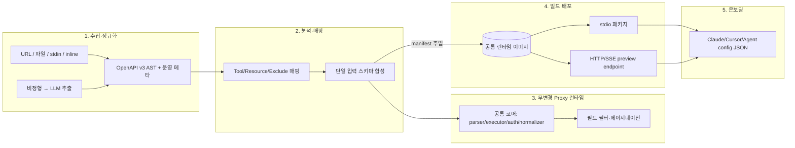

# PRD-Adv-2nd — REST API → MCP 변환 플랫폼 (wise-mcp-base 2차)

## 1. 문서 정보

| 항목 | 내용 |
|------|------|
| 문서 버전 | 2.0 (2차, Advanced) |
| 작성일 | 2026-05-31 |
| 상태 | 초안 — 구현 가능 수준의 요구·아키텍처·스택 확정 |
| 선행 문서 | [PRD.md](./PRD.md) (1차, HF 모델 카탈로그 MCP) |
| 근거 자료 | `.docs/Perplexity-Restapi로 제공되는 서비스를 간단하게 mcp server 변경하는 컨버젼 플랫폼.md` (오픈소스 조사·5단계 아키텍처·필드 필터링·인증·오케스트레이션·LLM 스펙 추출) |
| 프로토콜 근거 | [MCP Specification](https://modelcontextprotocol.io/specification/2025-11-25), [TypeScript SDK](https://github.com/modelcontextprotocol/typescript-sdk) |

### 1.1 1차 대비 변경 요지

1차 PRD는 **특정 도메인(HF 모델 카탈로그)을 MCP 도구로 노출**하는 단일 서버 템플릿이었다. 2차는 도메인을 일반화한다 — **임의의 REST API 문서(OpenAPI URL/파일 또는 비정형 HTML/PDF/Markdown)를 입력받아 즉시 래핑 MCP 서버로 변환·배포하고, 클라이언트 등록 가이드까지 출력하는 컨버전 플랫폼**으로 확장한다.

핵심 차이는 **선언형 프록시(proxy-by-spec) 모델**이다: API별 커스텀 코드를 생성하지 않고, 고정된 공통 프록시 런타임 + API별 manifest(스펙·설정·정책)만 교체하여 동작한다. 1차의 수집·정규화·분류 계층 분리 원칙과 `@modelcontextprotocol/sdk` 기반 stdio/HTTP 운송, docker-compose 운영 규약은 그대로 계승한다.

---

## 2. 목적 및 배경

### 2.1 목적

- 사용자가 **REST API 문서 사이트 URL 또는 파일을 업로드**하면, 플랫폼이 (1) 문서 접근·분석, (2) OpenAPI 정규화, (3) 래핑 MCP 서버 자동 생성, (4) 빌드·배포, (5) MCP client/agent 등록 가이드 출력까지 **단일 흐름**으로 자동화한다.
- **무코드/저코드**: 원본 REST API와 프록시 런타임 코드는 변경하지 않는다. 행동은 **문서와 manifest로만 결정**된다.
- **에이전트 친화성**: 단순 변환을 넘어 **필드 필터링·페이지네이션 강제·응답 축소**로 컨텍스트 윈도 비용을 낮춘다.

### 2.2 배경 요약 (조사 문서 정합)

- 현존 오픈소스(`mcp-openapi-server`, `mcp-link`, `mcp4openapi`, `api-to-mcp`, `FieldFlow`, `FastMCP`)는 대부분 **"OpenAPI 스펙이 이미 존재한다"**는 전제를 둔다. 따라서 **문서 ingestion + 분석 + 배포 + 온보딩 UX**가 본 플랫폼의 차별화 지점이다.
- 변환 엔진은 재사용하되(아래 §6), **무변경 프록시 런타임 + manifest 주입** 구조로 멀티테넌트 운영·롤백·배포 자동화·보안 통제를 표준화한다.
- 비정형 문서 → OpenAPI 추출은 완전 자동 생성이 아니라 **LLM 초안 + 정적 검증 + 규칙/인간 보정**의 3중 구조가 현실적이다.

---

## 3. 이해관계자 및 성공 기준

| 이해관계자 | 관심사 | 성공 기준 (측정 가능) |
|------------|--------|------------------------|
| 플랫폼 사용자 | 문서 한 건으로 동작하는 MCP | URL/파일 입력 후 N분 내 `tools/list` 응답하는 preview endpoint 획득 |
| 에이전트 개발자 | 등록 즉시 사용 | Claude Desktop/Cursor용 config JSON snippet 복붙으로 연결 성공 |
| 운영 | 무변경 배포·격리 | 동일 프록시 이미지 + manifest만 교체로 신규 API 온보딩, `/health` 200 |
| 보안 | 비밀·민감 endpoint 통제 | secret은 외부 manager 참조, `/admin`·민감 tag 자동 제외 |

---

## 4. 기능 요구사항 (상·중·하 분류 표)

### 4.1 대분류 A — 문서 수집·정규화 (Ingestion)

| 중분류 | 소분류 | 설명 | 우선순위 | 수용 조건 |
|--------|--------|------|----------|-----------|
| A1 입력 | OpenAPI URL/파일 | JSON/YAML v3 우선 탐지 | MUST | URL·파일·stdin·inline 4종 입력 |
| A2 입력 | 비정형 문서 | HTML/PDF/Markdown/Postman/curl 수집 → 추출 분기 | SHOULD | 추출 후보로 라우팅, 실패 시 명시적 오류 |
| A3 정규화 | OpenAPI v3 AST | `$ref` 해석, 파라미터·requestBody 병합 | MUST | 정규화된 단일 AST 산출 |
| A4 메타데이터 | 운영 메타 추출 | base URL, 인증 방식, endpoint 수, tag, 위험 endpoint, 품질 점수 | MUST | manifest에 메타 필드 존재 |

### 4.2 대분류 B — 분석·매핑 (Mapping Plan)

| 중분류 | 소분류 | 설명 | 우선순위 | 수용 조건 |
|--------|--------|------|----------|-----------|
| B1 매핑 | Tool 기본 매핑 | 모든 endpoint → MCP Tool | MUST | operationId 우선, 없으면 method+path slug |
| B2 매핑 | Resource 승격 | 조회성 GET → Resource/ResourceTemplate 후보 | COULD | 규칙 기반 승격, 근거 기록 |
| B3 제외 | 위험 endpoint | `/admin`·`/internal`·민감 tag·위험 operation 자동 제외 | MUST | 제외 목록·사유 manifest 기록, 승격은 승인 필요 |
| B4 입력 합성 | 단일 입력 스키마 | path/query/header/body → 단일 MCP 입력 스키마 | MUST | JSON Schema 생성, 검증 통과 |

### 4.3 대분류 C — 무변경 Proxy MCP 런타임

| 중분류 | 소분류 | 설명 | 우선순위 | 수용 조건 |
|--------|--------|------|----------|-----------|
| C1 런타임 | 공통 프록시 코어 | transport·spec parser·request executor·auth injector·response normalizer | MUST | API별 코드 0줄, manifest만으로 동작 |
| C2 설정 | 가변 manifest | spec URL, base URL, header template, include/exclude, timeout, retry, rate limit | MUST | manifest 스키마 문서화·검증 |
| C3 운송 | stdio | 로컬 호스트(Claude Desktop/Cursor) 연동 | MUST | stdio 실행 패키지 산출 |
| C4 운송 | Streamable HTTP/SSE | 원격·멀티에이전트, 세션 관리·스트리밍 | MUST | `/mcp` endpoint, stateless 옵션 |
| C5 필드 필터 | 응답 축소 | `fields`·`expand`·`limit`·`cursor`·`sort` 파라미터, post-filtering | SHOULD | 토큰 절감 측정 가능, allow-list 우선 |
| C6 컨텍스트 절감 | 강제 정책 | 페이지네이션 기본(limit 20), 긴 텍스트 truncation, 중첩 depth 제한 | SHOULD | 정책 manifest로 조정 가능 |

### 4.4 대분류 D — 인증 (Auth)

| 중분류 | 소분류 | 설명 | 우선순위 | 수용 조건 |
|--------|--------|------|----------|-----------|
| D1 추론 | securitySchemes 파싱 | API Key/Bearer/Basic/OAuth2/OIDC 식별 | MUST | operation-level auth matrix 생성 |
| D2 주입 | auth injector 플러그인 | header/query/cookie 공통 삽입 | MUST | 런타임 플러그인화 |
| D3 정책 분리 | spec_auth vs runtime_auth_policy | 스펙 추론과 운영 정책(키 로테이션·rate-limit bucket) 분리 | SHOULD | manifest 2-섹션 분리 |
| D4 비밀 | 외부 secret 참조 | secret은 스펙에 미저장, 참조 키만 manifest | MUST | 로그·manifest에 비밀 평문 부재 |
| D5 오류 정규화 | 구조화 error | `AUTH_EXPIRED`·`MISSING_SCOPE`·`INVALID_API_KEY`·`UPSTREAM_AUTH_UNAVAILABLE` | SHOULD | raw 401 미노출, MCP error 코드화 |

### 4.5 대분류 E — 빌드·배포·오케스트레이션 (Ops)

| 중분류 | 소분류 | 설명 | 우선순위 | 수용 조건 |
|--------|--------|------|----------|-----------|
| E1 빌드 | 공통 런타임 이미지 | 1회 빌드, manifest 주입형 | MUST | `docker compose up` 성공 |
| E2 배포 | 2 타깃 | stdio 패키지 + HTTP/SSE preview endpoint | MUST | 둘 다 산출, readiness probe |
| E3 K8s | manifest 주입 | ConfigMap/Secret로 spec·auth·route 규칙 주입 | COULD | stateless Deployment, HPA(custom metric) |
| E4 GitOps | Argo CD/Flux | manifest commit → preview/tenant namespace 배포 | COULD | readiness에서 `tools/list`·샘플 호출·auth 검증 |
| E5 운영 모델 | per-api vs shared | 격리(per-api) / 비용(shared multi-tenant) 선택 | COULD | 선택 기준 문서화 |

### 4.6 대분류 F — LLM 기반 스펙 추출 (비정형 → OpenAPI)

| 중분류 | 소분류 | 설명 | 우선순위 | 수용 조건 |
|--------|--------|------|----------|-----------|
| F1 수집 | 문서·DOM | HTML 사이트 DOM·링크 그래프, `/authentication`·`/errors`·`/pagination` 공통 페이지 우선 | SHOULD | 공통 모델 병합 |
| F2 구조 추출 | 중간 표현(IR) | endpoint/method/auth/params/examples/confidence JSON IR | SHOULD | 요약 아닌 구조 추출 |
| F3 LLM 초안 | fragment → 병합 | segment별 OpenAPI fragment → path/operation 병합 | SHOULD | 초안 생성, confidence map |
| F4 정적 검증 | validator | syntax·`$ref`·content-type·required 검증 | MUST | 검증 실패 항목 리포트 |
| F5 실행 검증 | sandbox 샘플 호출 | 가능 시 path·query·auth·response 보정 | COULD | 저 confidence 구간만 재검토 |
| F6 산출물 | unresolved questions | 신뢰도 낮은 항목·불명확 auth header 목록 | SHOULD | 사람 보정 큐로 전달 |

---

## 5. 비기능 요구사항

| 구분 | 요구 | 비고 |
|------|------|------|
| 무변경성 | 원 REST API·프록시 코드 불변 | 행동은 문서+manifest로만 결정 |
| 확장성 | 수집·분석·변환·배포 계층 분리 | 신규 입력 포맷·신규 변환 엔진 삽입 용이 |
| 성능 | 필드 필터·페이지네이션·truncation | 컨텍스트 윈도 비용 절감(목표 토큰 절감 측정) |
| 보안 | secret 외부 참조, 민감 endpoint 제외, mTLS/egress 정책 | spec_auth와 runtime_auth_policy 분리 |
| 멀티테넌트 | tenant 격리·장애 반경 최소화 | per-api 분리 또는 shared+manifest routing |
| 관측 | 구조화 로그, `/health`, `tools/list` 프로브, tracing | 인증 오류 코드화로 재시도·관측 용이 |
| 라이선스 | 채택 오픈소스 라이선스 호환 명시 | mcp-link 등 포크 시 LICENSE 확인 |

---

## 6. 기술 스택 및 오픈소스 선정 (증거 링크)

### 6.1 변환 엔진 후보 비교

| 오픈소스 | 저장소 | 핵심 | 적합성 | 한계 |
|----------|--------|------|--------|------|
| **mcp-openapi-server** | [GitHub](https://github.com/ivo-toby/mcp-openapi-server) | URL·파일·stdin·inline 입력, stdio/HTTP, tool filtering, AuthProvider, `$ref` 해석, 스키마 병합 | **플랫폼 코어 엔진 1순위** | 웹 UI·즉시 배포 UX 직접 구현 |
| **mcp-link** | [GitHub](https://github.com/automation-ai-labs/mcp-link) | OpenAPI v3 → MCP 자동 변환, hosted version, Zero Code Modification 명시 | **MVP UX 2순위** | 커스텀 인증·확장성 제한적, HTML 역추론 미지원 |
| mcp4openapi | [GitHub](https://github.com/thoughtworks/mcp4openapi) | 범용 OpenAPI 프록시 POC | 아키텍처 벤치마크 | POC 성격, 제품화 검증 필요 |
| api-to-mcp | [GitHub](https://github.com/TykTechnologies/api-to-mcp) | OpenAPI → MCP 동적 변환, Tyk 생태계 | API 게이트웨이·정책 통합 시 | 문서/운영 정보 제한적 |
| FieldFlow | [GitHub](https://github.com/guillaumegay13/fieldflow) | selective fields, FastAPI proxy, 최대 80% 토큰 절감 주장 | **필드 필터링 계층** | 범용성보다 필드 최적화 중심 |
| FastMCP | [docs](https://gofastmcp.com/integrations/openapi) | RouteMap 기반 Tool/Resource/Exclude 세밀 제어 | **RouteMap/Exclude 정책 참고** | 복잡 API 그대로 노출 시 agent 사용성 저하(공식 인정) |
| rmcp-openapi | [GitLab](https://gitlab.com/lx-industries/rmcp-openapi) | OpenAPI → MCP tools, 바이너리 제공 | GitLab 대안 | 문서·커뮤니티 노출 적음 |

### 6.2 선정 요약

- **코어 변환 엔진**: `ivo-toby/mcp-openapi-server` (TS, 재사용성 최고).
- **즉시 체험/MVP UX 참고**: `automation-ai-labs/mcp-link` (Zero Code Modification 흐름).
- **결합 전략**: "Proxy-only 런타임 + FieldFlow 스타일 필드 필터 + FastMCP 스타일 RouteMap/Exclude". 하나만 고르지 않고 **역할 분리 결합**이 제품적으로 유리.
- **기본 구현 언어**: Node.js + TypeScript + `@modelcontextprotocol/sdk` (1차 계승). LLM 스펙 추출 배치는 Python 보조 프로세스 병행 가능.

---

## 7. 시스템 구성 (5단계 파이프라인)

**핵심 불변식**: 2단계 산출물 = `normalized OpenAPI + proxy manifest(exposed operations, auth policy, fields policy)`. 3~5단계는 이 manifest만 소비한다. 런타임 코드는 고정.

---

## 8. 디렉터리 규약 (본 레포)

| 경로 | 역할 |
|------|------|
| `apps/api/` | 공통 Proxy MCP 런타임 (Streamable HTTP·stdio), manifest 소비 |
| `apps/web/` | 변환 플랫폼 UI (문서 업로드 → preview → config snippet) |
| `packages/converter/` | OpenAPI 정규화·매핑 엔진 (mcp-openapi-server 기반/참고) |
| `packages/extractor/` | 비정형 문서 → OpenAPI LLM 추출 파이프라인 |
| `packages/manifest/` | manifest 스키마·검증·정책 병합 |
| `python/extractor/` | LLM 스펙 추출 배치 보조 (uv·`pyproject.toml`) |
| `ops/` | Docker Compose, K8s(ConfigMap/Secret/HPA), GitOps(Argo/Flux) 샘플 |
| `samples/` | MCP client·agent 등록 예제, config JSON 템플릿 |
| `.docs/` | PRD·조사 기록 |

패키지 관리: **pnpm** 워크스페이스, Python은 **uv**.

---

## 9. 마일스톤

| 단계 | 산출물 | 상태 |
|------|--------|------|
| M0 | 본 2차 PRD | 완료 |
| M1 | 공통 Proxy 런타임 `apps/api` + manifest 스키마 (OpenAPI URL 입력 → stdio/HTTP `tools/list`) | 구현 |
| M2 | `packages/converter` 정규화·매핑 + 위험 endpoint 제외 + 단일 입력 스키마 | 구현 |
| M3 | 필드 필터·페이지네이션·인증 injector + 구조화 오류 | 구현 |
| M4 | `apps/web` 업로드 → preview → config snippet 온보딩 UX | 구현 |
| M5 | `packages/extractor` 비정형 문서 LLM 추출(초안+검증+보정) | 구현 |
| M6 | K8s/GitOps 멀티테넌트 배포, 관측·HPA 하드닝 | 예정 |

---

## 10. 리스크 및 완화

| 리스크 | 완화 |
|--------|------|
| 비정형 HTML 역추론 정확도 한계 | LLM 초안 + 정적 검증 + confidence map + unresolved questions 큐 |
| 복잡 API 그대로 노출 시 agent 사용성 저하 | RouteMap/Exclude 정책 + 필드 필터 curation (FastMCP 공식 한계 반영) |
| 인증 다양성(OAuth2 등) | securitySchemes 파싱 + auth injector 플러그인 + spec_auth/runtime 정책 분리 |
| 비밀 유출 | secret 외부 manager 참조, 로그·manifest 평문 부재 |
| 멀티테넌트 장애 반경 | per-api 분리 vs shared 선택 기준 명시, namespace 격리 |
| 채택 OSS 라이선스 | 포크·임베드 전 LICENSE 검토 |

---

## 11. 참고 링크 (요약)

- MCP: https://modelcontextprotocol.io/
- TS SDK: https://github.com/modelcontextprotocol/typescript-sdk
- mcp-openapi-server: https://github.com/ivo-toby/mcp-openapi-server
- mcp-link: https://github.com/automation-ai-labs/mcp-link
- mcp4openapi: https://github.com/thoughtworks/mcp4openapi
- api-to-mcp: https://github.com/TykTechnologies/api-to-mcp
- FieldFlow: https://github.com/guillaumegay13/fieldflow
- FastMCP OpenAPI: https://gofastmcp.com/integrations/openapi

---

## 12. 변경 이력

| 버전 | 일자 | 내용 |
|------|------|------|
| 1.0 | 2026-04-10 | 1차 PRD — HF 모델 카탈로그 MCP 템플릿 |
| 2.0 | 2026-05-31 | 2차 PRD — REST API → MCP 변환 플랫폼(선언형 프록시·필드 필터·LLM 스펙 추출)으로 확장 |
